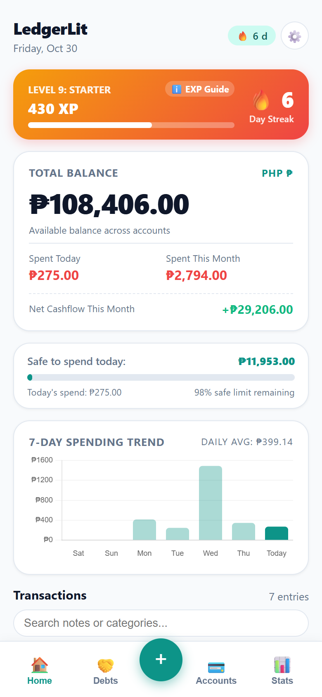
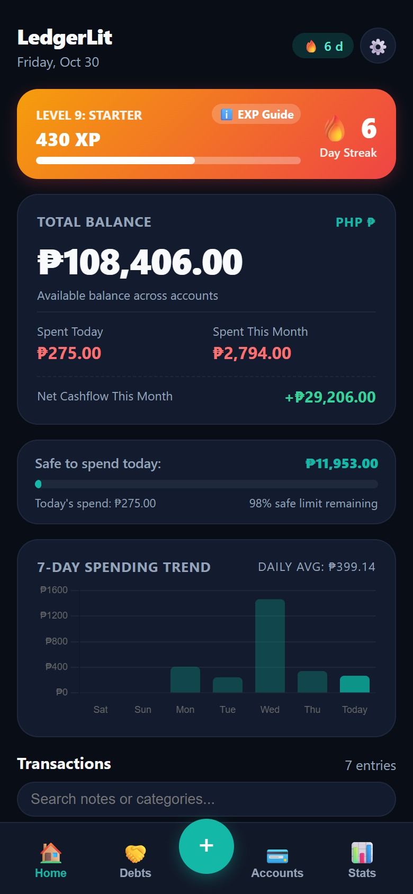
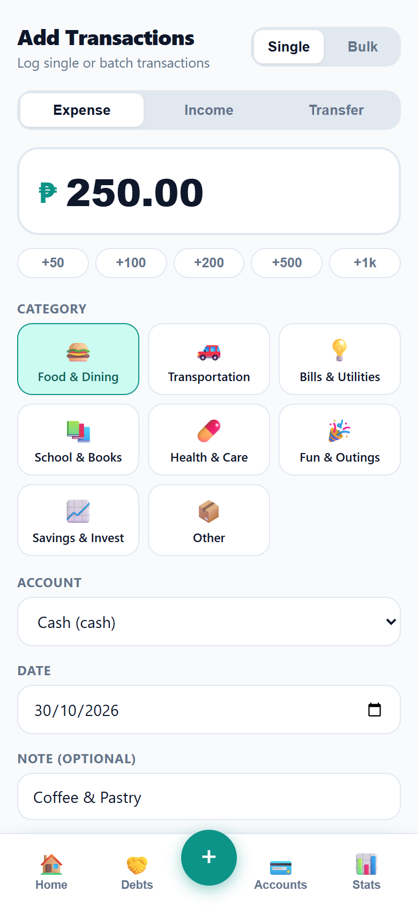
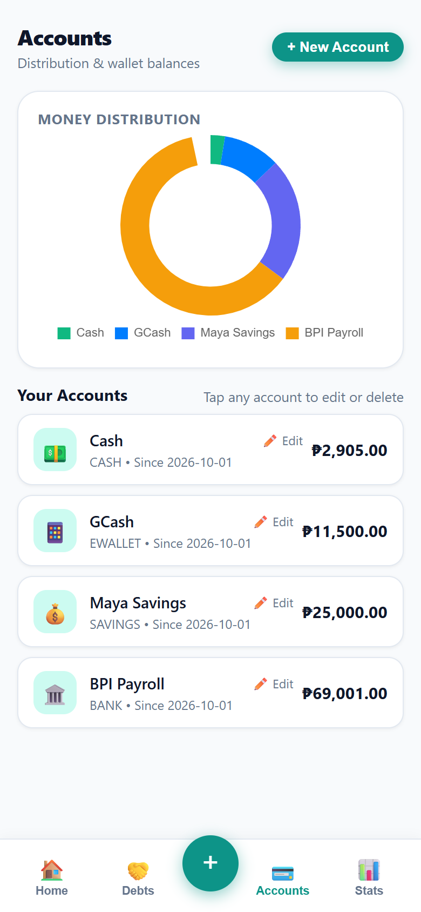
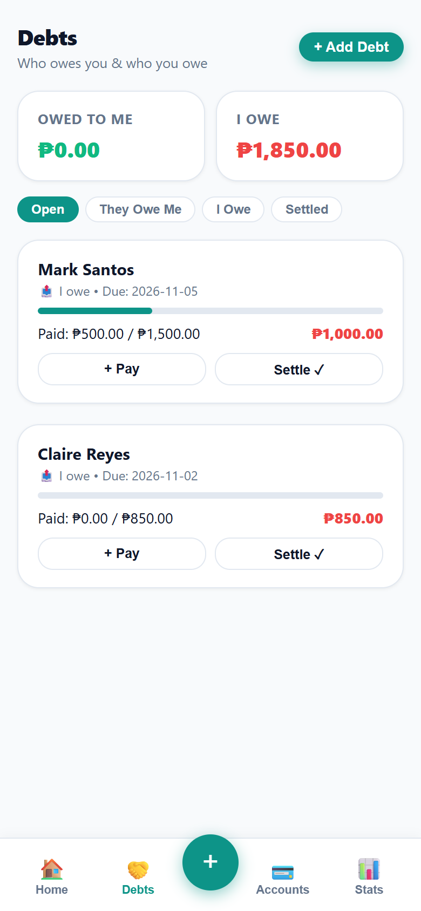
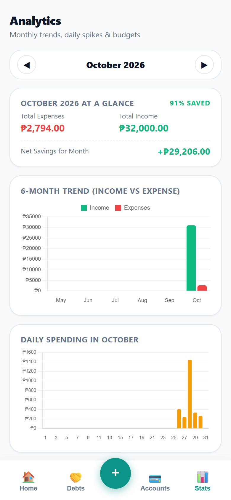
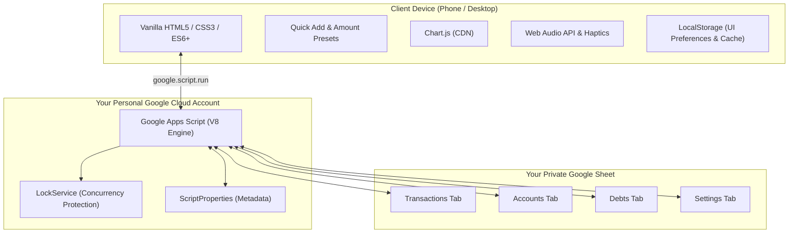

# LedgerLit 🔥📊

> **Track smarter. Streak harder.**  
> A fast, zero-friction, 100% private personal finance tracker running completely free on Google Apps Script and Google Sheets.

[](LICENSE)
[](#the-inspiration--philosophy)
[](#privacy--data-sovereignty)
[](#tech-stack)
[](#-app-previews)

---

## 💡 The Inspiration & Philosophy

Why build another finance tracker when app stores are full of them?

Most modern finance apps come with friction:
- **Subscription paywalls:** Charging \$5 to \$10 every month just to view your own spending trends or export CSVs.
- **Login fatigue:** Mandatory signups, forgotten passwords, 2FA codes, and expired sessions right when you need to log a quick coffee.
- **Privacy trade-offs:** Handing over sensitive financial records, income, and debt details to venture-backed third-party servers.
- **Over-engineered complexity:** Features you never use, bloated with bank-sync integrations that constantly break.

**LedgerLit** was built out of a desire for **personal financial sovereignty** and **gamified consistency**.

### The Core Principles:
1. **100% Free Forever:** Uses the reliable Google ecosystem you already have (Google Apps Script + Google Sheets). No monthly bills, no credit cards.
2. **Zero Logins, Zero Friction:** Deploy it once as a private Google Web App. When added to your phone's home screen, it opens instantly without login screens or credential prompts.
3. **Complete Privacy:** Zero external databases. Zero analytics. Zero third-party telemetry. Your financial records live exclusively inside **your personal Google Sheet**.
4. **Personalized Over Scalable:** It's not a multi-tenant corporate SaaS trying to scale to a million users. It is designed to be deeply personal, lightweight, and tailored to daily habits.

---

## 📱 App Previews

<div align="center">
  <table>
    <tr>
      <td align="center"><b>Home Dashboard (Light)</b></td>
      <td align="center"><b>Home Dashboard (Dark)</b></td>
      <td align="center"><b>Quick Add</b></td>
    </tr>
    <tr>
      <td align="center"></td>
      <td align="center"></td>
      <td align="center"></td>
    </tr>
    <tr>
      <td align="center"><b>Accounts & Distribution</b></td>
      <td align="center"><b>Two-Way Debt Tracker</b></td>
      <td align="center"><b>Monthly & Daily Analytics</b></td>
    </tr>
    <tr>
      <td align="center"></td>
      <td align="center"></td>
      <td align="center"></td>
    </tr>
  </table>
</div>

---

## ✨ Features

### ⚡ Quick Add (< 5 Seconds)
- **Big Numeric Keypad & Amount Presets:** Quick `+50`, `+100`, `+200`, `+500`, `+1k` buttons for lightning speed thumb entries.
- **Instant Category Chips:** Food, Transport, Utilities, Shopping, Entertainment, Health, Education, Salary, and custom tags.
- **Multi-Account Selector:** Route payments to Cash, e-wallets, Banks, or Savings.
- **Bulk Add Mode:** Rapidly enter multiple transactions across different dates in one batch.

### 📊 Visual Dashboard & Analytics
- **Live Net Balance & Safe-to-Spend:** Real-time visibility into your current money distribution and daily budget limits.
- **7-Day Spending Curve:** Interactive bar/line chart showing weekly spending momentum.
- **Daily Spending Chart:** Visual distribution of daily spend throughout the current month to catch spikes.
- **6-Month Cash Flow:** Income vs. Expense comparison bars to track monthly net savings rate.
- **Category Spending Donut:** Responsive donut chart highlighting where your money goes.

### 🏦 Multi-Account Management
- Track individual balances across multiple accounts (e.g., Physical Cash, e-wallets, Banks, Emergency Fund).
- **Account Start Date Protection:** Past transaction edits or historical logs won't distort current account balances.
- In-app account creation, editing, and safe deletion.

### 🤝 Two-Way Debt Tracker
- **"They Owe Me" & "I Owe Them":** Track both receivables and payables in one place.
- **Partial Payments:** Record partial repayments with full historical tracking.
- **Auto-Settlement:** Automatically transitions debts to *Settled* once fully paid.
- **Overdue Alerts:** Visual reminders for overdue repayments.

### 🎮 Gamification & Healthy Habits
- **Daily Logging Streaks:** Keep the flame 🔥 burning by logging daily entries.
- **EXP & Level Progression:** Earn experience points (XP) for logging transactions, settling debts, and maintaining budgets.
- **Automated Zero-Spend Rewards:** Earn +10 XP automatically on days you spend ₱0 / \$0.
- **Tactile Feedback:** Built-in Web Audio API sound effects (save chimes, level-up fanfares) and native device haptics.

### 📥 Data Portability
- **Google Keep Import:** Easily import raw transaction notes pasted from Google Keep or text notes.
- **One-Click CSV Export:** Download your entire transaction ledger anytime.

---

## 🚀 5-Minute Setup Guide

You can deploy your own private instance of LedgerLit using either method below.

### Method 1: No-Code / Direct Copy (Easiest)

1. **Create a new Google Sheet:**
   - Go to [Google Sheets](https://sheets.new) and create a blank spreadsheet named `LedgerLit`.
2. **Open the Apps Script Editor:**
   - In the Google Sheet menu, click **Extensions** → **Apps Script**.
3. **Copy the Source Files:**
   - Rename `Code.gs` in the editor and paste the contents of [`src/Code.gs`](src/Code.gs).
   - Click the **+** button next to *Files* → choose **HTML** → name it `index` (which creates `index.html`).
   - Paste the contents of [`src/index.html`](src/index.html) into it.
4. **Initialize the Database:**
   - At the top toolbar, select `setupSheets` from the function dropdown and click **Run**.
   - Grant the necessary Google authorization when prompted.
   - Look at your Google Sheet—it will now have the `Transactions`, `Accounts`, `Debts`, `Settings`, and `Goals` tabs automatically formatted!
5. **Deploy the Web App:**
   - In Apps Script, click the blue **Deploy** button (top right) → **New deployment**.
   - Click the gear icon ⚙️ next to *Select type* → choose **Web app**.
   - Configure:
     - **Description:** `LedgerLit v1.0`
     - **Execute as:** `Me (your_email@gmail.com)`
     - **Who has access:** `Only myself`
   - Click **Deploy** and copy your **Web app URL**.

---

### Method 2: Developer Setup via `clasp` (CLI)

```bash
# 1. Clone this repository
git clone https://github.com/jjoosseepphh11/LedgetLit.git
cd LedgetLit

# 2. Install Google Clasp globally
npm install -g @google/clasp

# 3. Log in to your Google Account
clasp login

# 4. Create or bind to your Google Sheet script
# Copy .clasp.json.example to .clasp.json and paste your scriptId:
cp .clasp.json.example .clasp.json

# 5. Push code to Google Apps Script
clasp push

# 6. Open the Apps Script editor to run setupSheets and deploy
clasp open
```

---

## 📲 Add to Phone Home Screen

Once you have your deployed Web App URL:

- **iOS (Safari):**
  1. Open the Web App URL in Safari.
  2. Tap the **Share** button (box with upward arrow).
  3. Scroll down and tap **Add to Home Screen**.
- **Android (Chrome):**
  1. Open the Web App URL in Chrome.
  2. Tap the three dots menu (**⋮**) in the top right.
  3. Tap **Install app** or **Add to Home screen**.

Now, LedgerLit opens instantly with a native full-screen feel—no browser address bars, and no login prompts.

---

## 🛠️ Architecture & Tech Stack



- **Runtime:** Google Apps Script (V8 Engine) + `HtmlService`.
- **Frontend:** Clean Vanilla JavaScript, CSS custom properties (responsive, dark-mode ready), no build step.
- **Charts:** [Chart.js](https://www.chartjs.org/) served via jsDelivr CDN.
- **Database:** Google Sheets with automated schema initialization.
- **Security:** Zero external APIs or tracking scripts. Data never leaves your Google account.

---

## 🔒 Privacy & Data Sovereignty

- **No Third-Party Access:** The web app executes strictly under your Google credentials (`Execute as: Me`).
- **No Database Sharing:** Your spreadsheets are stored directly in your Google Drive.
- **No Ads or Trackers:** Pure code with zero tracking pixels or analytics libraries.

---

## 🤝 Contributing & Customization

Feel free to fork this project and adapt it to your specific financial workflow! If you have ideas for UX enhancements, optimizations, or new charts, pull requests and issues are welcome.

---

## 📄 License

This project is licensed under the [MIT License](LICENSE) — you are free to copy, modify, and distribute it for personal or commercial use.

---

*Crafted with ❤️ for personal financial freedom and privacy.*
